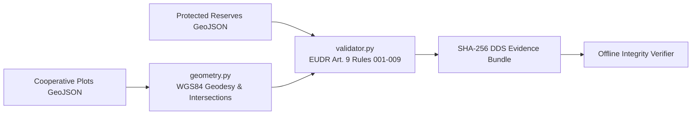

# eudr-trace

[](https://github.com/codesphere-u/eudr-trace/actions/workflows/ci.yml)
[](LICENSE)
[](pyproject.toml)
[](pyproject.toml)

**Offline-first EU Deforestation Regulation (Regulation (EU) 2023/1115) Article 9 smallholder GeoJSON validator, spherical geodesic hectare calculator, overlap/reserve checker, and SHA-256 Due Diligence proof kit.**

- **Mission Domain:** Climate Change & Smallholder Agriculture
- **Stack:** Pure Python 3.11+ (zero runtime third-party dependencies, `mypy --strict`, `ruff`, `pytest`)
- **Maintainer:** Codesphere Innovations (U) Limited (`codesphere-u`)

---

## Problem Solved

Smallholder coffee, cocoa, rubber, soya, and timber cooperatives face exclusion from European markets under Regulation (EU) 2023/1115 because commercial EUDR compliance SaaS platforms charge per-farmer fees and fail completely in offline rural zones.

## Key Features

- Zero C-binary dependencies (no GDAL/GEOS/Shapely required): pure-Python Chamberlain-Duquette spherical geodesic area calculation in hectares.
- Enforces EU TRACES NT 6-decimal coordinate precision (`EUDR-003`), WGS84 bounds & Null Island detection (`EUDR-002`), and the legal `>= 4.0 ha` Polygon requirement (`EUDR-006`).
- Detects unclosed rings, clockwise winding warnings (`EUDR-004`), bowtie self-intersections (`EUDR-005`), pairwise cooperative plot overlaps (`EUDR-007`), and protected forest reserve encroachments (`EUDR-008`).
- Exports and offline-verifies tamper-evident canonical SHA-256 Due Diligence Statement (DDS) evidence bundles.

## Architecture Overview



See [docs/architecture.md](docs/architecture.md) for module-level design details.

## Installation

```bash
git clone https://github.com/codesphere-u/eudr-trace.git
cd eudr-trace
uv sync --extra dev
```

Or install in editable mode with standard `pip`:

```bash
pip install -e ".[dev]"
```

## Quick Start (CLI)

```bash
eudr-trace demo
eudr-trace validate plots.geojson --reserves reserves.geojson --bundle-out dds.json
eudr-trace verify-bundle dds.json
```

## Quick Start (Python API)

```python
from eudr_trace import create_dds_evidence_bundle, validate_feature_collection, verify_dds_evidence_bundle
from eudr_trace.cli import DEMO_PLOTS

report = validate_feature_collection(DEMO_PLOTS)
bundle = create_dds_evidence_bundle(report, operator_name="Mt. Elgon Coop", batch_reference="B-01")
assert report.passed and verify_dds_evidence_bundle(bundle)[0]
```

## Testing & Quality Gates

```bash
uv run ruff check src tests
uv run mypy src
uv run pytest -v
```

## Security, Contributing & Roadmap

- **Security:** See [SECURITY.md](SECURITY.md) for responsible disclosure procedures.
- **Contributing:** See [CONTRIBUTING.md](CONTRIBUTING.md) and [CODE_OF_CONDUCT.md](CODE_OF_CONDUCT.md).
- **Changelog & Roadmap:** See [CHANGELOG.md](CHANGELOG.md) and [ROADMAP.md](ROADMAP.md).

## License

MIT License — see [LICENSE](LICENSE).

## Support & Contact

Open an issue on [GitHub Issues](https://github.com/codesphere-u/eudr-trace/issues) or contact `codesphereinnovationz@gmail.com`.
